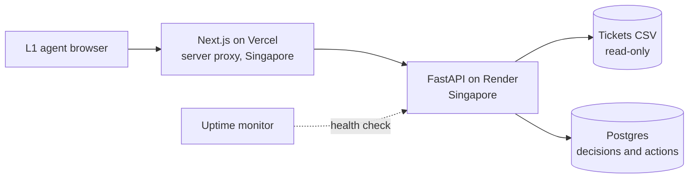

# RideOps Pre-Escalation Check

An internal tool for L1 support agents. It clears tickets that already have an engineering verdict, then checks whether each new ticket really needs engineering.

**Live demo:** <https://rideops-precheck.vercel.app> (no login needed)

## The result

| Finding | Number |
| --- | --- |
| Open tickets that already have an engineering verdict | **34 of 48** (71%) |
| Of those, still labelled "with Engineering" | **19** |
| Marked Fixed and waiting on client confirmation | **12**, so open tickets could move from 48 to 36 |
| Escalations returned without a fix | **275 of 486** (56.6%), of which 253 are clearly avoidable |
| Engineering trips spent on tickets it did not fix | **528 of 777** (68.0%) |
| Average open tickets, 19-31 Jul to Sep | **+63.9%** (arrivals +40.2%, time open +16.9%) |

The 48-to-36 drop is a one-time scenario that needs client confirmation. Volume drove about two-thirds of the rise, so this tool alone will not restore July levels.

## What it does

- **Burn-down:** sorts the 48 snapshot tickets into next-action lanes and flags status mismatches.
- **Pre-escalation check:** asks for written proof of each required step and gives an advisory verdict.
- **P1 fast path:** P1 tickets are never held or gated.
- **Monitor and Enforce:** Monitor logs advice and blocks nothing. Enforce asks for the missing proof or a logged reason.
- **Known issues and draft playbooks:** shows repeated duplicates and category steps as warnings.
- **Impact:** shows live activity, weekly trends, guardrails and the replay.

## Replay evidence

September replay of 189 escalations:

| Policy | Held | True bugs delayed | Avoidable flagged | P1s held |
| --- | ---: | ---: | ---: | ---: |
| v1: history and config rules hold | 35 | 16 of 78 | 19 | 0 of 9 |
| v2: history holds | 25 | 10 of 78 | 15 | 0 of 9 |
| **v3: history warns, proof gates** | **0** | **0 of 78** | **15, as warnings** | **0 of 9** |

The v3 zero is true by design and is not a live result. Past tickets have no recorded proof, so the missing-proof gate could not be replayed. v3 was designed after seeing September, so this is **not a clean holdout**.

## Architecture



- `backend/`: check, burn-down, known issues, replay, metrics and name masking.
- `web/`: Burn-down, Queue, ticket workspace and Impact.
- The web proxy keeps the API code on the server and forwards only allowlisted routes.
- Verdicts use only triage fields and outcomes closed before the ticket was created.
- Actions are recorded in the tool and never change the source data.

## Run locally

Requires Python 3.12, Node 20.19 or later, and the case study CSV. Keep the CSV outside the repository.

```bash
cd backend
python3.12 -m venv .venv
.venv/bin/pip install -r requirements-dev.txt
cp .env.example .env   # set ACCESS_CODE and RIDEOPS_DATA_PATH
.venv/bin/uvicorn app.main:app --port 8000
```

In a second terminal:

```bash
cd web
npm ci
cp .env.example .env.local   # set the same ACCESS_CODE
npm run dev
```

Open <http://localhost:3000>.

## Environment variables

| Service | Variable | Purpose |
| --- | --- | --- |
| API | `ACCESS_CODE` | Shared code required on API requests |
| API | `RIDEOPS_DATA_PATH` | Absolute path to the tickets CSV |
| API | `DATABASE_URL` | SQLite by default, or a `postgresql://` URL |
| API | `MASK_NAMES` | `true` replaces names with `Client NNN` and `Agent A`-`H` |
| API | `WARM_REPORTS` | `true` starts computing the backtest at startup |
| API | `PRECHECK_MODE` | `monitor` (default) or `enforce` |
| Web | `API_BASE_URL` | API base URL, without `/api/v1` |
| Web | `ACCESS_CODE` | Same value as the API; used only by the server proxy |

## Tests

```bash
cd backend && .venv/bin/pytest && .venv/bin/ruff check . && .venv/bin/ruff format --check .
cd web && npm test && npm run lint && npm run typecheck
```

The suite has 111 backend tests and 61 web tests, including checks that future outcomes cannot affect a past verdict.

## Deploy notes

- **API:** `render.yaml` defines a Docker service. Add the CSV as a Render secret file and set `ACCESS_CODE`, `MASK_NAMES`, `PRECHECK_MODE` and a Postgres `DATABASE_URL`.
- **Web:** deploy `web/` to Vercel and set `API_BASE_URL` and `ACCESS_CODE` as server-side variables. `web/vercel.json` runs functions in Singapore, next to the API.
- **Cold starts:** Render's free tier sleeps after 15 idle minutes. An uptime monitor on `/api/v1/health` keeps it awake, but it uses the free instance hours shared across the workspace.

## Known limits

- **The demo has no login.** Anyone with the link can record actions, and the "Acting as" name is not verified.
- **The demo database is temporary.** Render's free Postgres expires on 2026-12-23, after which recorded actions are lost unless migrated.
- The verdict field has no timestamp and ticket status may lag it, so each of the 34 needs validation.
- Clearing a ticket is recorded activity, not proof the client's issue is resolved.
- Proof is checked for length and character variety only, so plausible filler can still pass and needs sampling.
- Masking is pseudonymous, not anonymous: labels follow sorted names and can be reversed with the source data.
- The data is one 13-week snapshot. Engineering effort and queue time are not in it, so any hours saved are assumptions.
